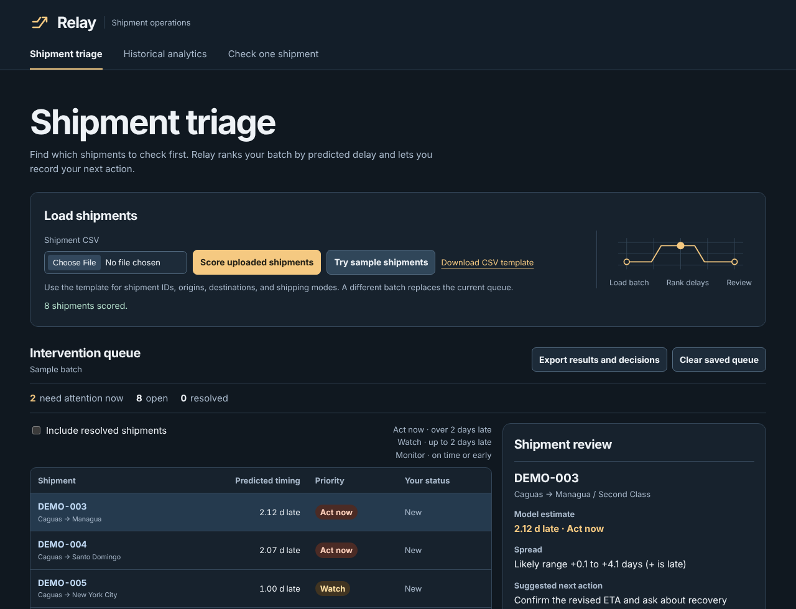
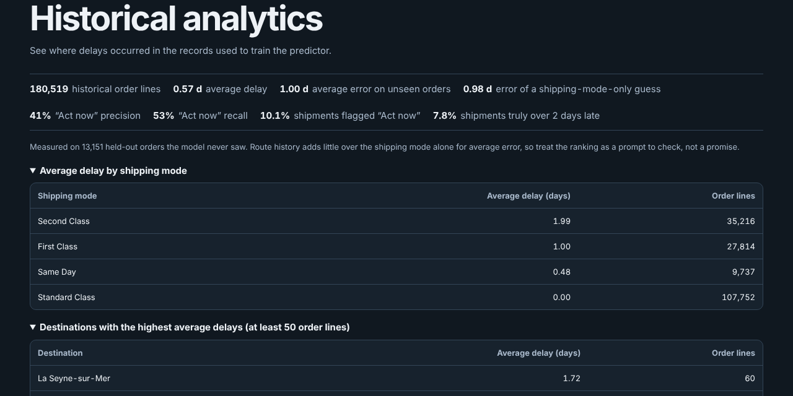

# Relay | Shipment triage

Relay ranks a batch of shipments by expected delay so a logistics team knows which ones to check first. It runs entirely in the browser: the trained model is a 0.4 MB file scored client-side, so shipment data never leaves the user's machine and the app deploys as static files.

## What it does

- **Shipment triage:** upload a CSV (`shipment_id, origin, destination, shipping_mode`) or try the sample. Shipments are ranked and labelled **Act now** (forecast over 2 days late), **Watch** (late by up to 2 days) or **Monitor**.
- **Decisions:** record a status and note per shipment. The queue and decisions are saved in the browser and can be exported to CSV with the forecast, a likely range and whether the route was in the training data.
- **Upload checks:** every bad row is reported with its spreadsheet row number before anything is scored.
- **Unseen routes:** a route missing from the training data gets its shipping mode's historical average and is marked as such.
- **Historical analytics** and **Check one shipment** use the same model.

## How well it works

The data has one row per order line, and lines of one order share route, mode and delay. The holdout is therefore split by **order**, so every test order is unseen. A random row split reported 0.55 days of error, which turned out to be leakage.

| Measure (13,151 held-out orders) | Value |
| --- | --- |
| Average error of the forest | 1.00 days |
| Average error of guessing each shipping mode's typical delay | 0.98 days |
| Shipments flagged Act now | 10.1% |
| Shipments truly over 2 days late | 7.8% |
| Act now precision (flagged that were truly late) | 41% |
| Act now recall (truly late that were flagged) | 53% |

Reviewing the flagged 10% finds about half of the badly late shipments, and flagged shipments are about five times more likely to be late than a typical one. Average error is no better than the mode-only baseline, so use the ranking to decide what to check first, not as a delivery promise. Route features (raw city codes and smoothed per-city averages) added almost nothing; delay in this data is set mostly by shipping mode. See the [model card](docs/MODEL_CARD.md) for method, limits and intended use.

## Run locally

Serve the browser files and open http://localhost:8000.

    python -m http.server 8000 --directory web/dist

## Refresh the model and run the tests

    python -m pip install -r requirements.txt
    python web/export_model.py . web/dist
    python -m unittest discover -s tests -v
    node --test tests/model.test.mjs

The exporter trains the forest, writes `web/dist/forest.json.gz` and `model-info.json`, and creates `web/parity.json`. A Node test checks that the browser predictor matches scikit-learn on 1,000 rows. GitHub Actions runs everything on each push.

## Deploy

Import the repository in Vercel and leave the root directory at the repository root. `vercel.json` serves `web/dist` with no build step.

## Data

[DataCo Smart Supply Chain](https://www.kaggle.com/datasets/shashwatwork/dataco-smart-supply-chain-for-big-data-analysis) (180,519 order lines, 65,752 orders), supplied as `compressed_data.csv.gz`. See the dataset listing for usage terms. Historical reports from the first version of the project are in [output.pdf](output.pdf) and [Output2.pdf](Output2.pdf).
